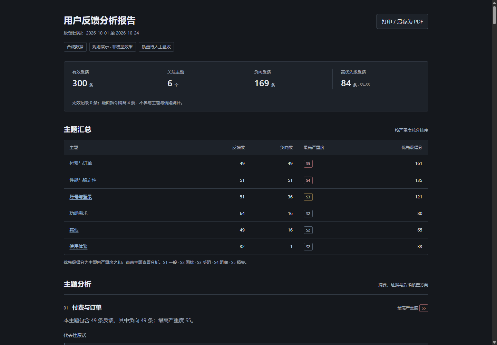

# 用户反馈洞察助手

把反馈 CSV 转为按主题排序、可追溯原话的一页 HTML。按随附《AI 产品经理三 Agent 试跑计划》限定六项功能：导入与脱敏、分类、聚合、证据摘要、报告、评测。Python 3.10+，运行时只用标准库，无需服务端、数据库或 npm 安装。

配套 Word 计划已同步更新为 Codex/GPT 版；未修改的原稿备份在 `docs/archive/原始试跑计划.docx`。



## 先运行演示

在项目目录打开 PowerShell：

```powershell
python -m src.feedback_insight demo --input data/feedback.csv --output reports/demo --synthetic
Start-Process reports/demo/report.html
```

如果应用内浏览器打开本地文件时报 `ERR_ACCESS_DENIED`，可用临时静态预览：

```powershell
python -m http.server 8765 --bind 127.0.0.1 --directory reports/demo
```

保持这个终端运行，再打开 [本地报告预览](http://127.0.0.1:8765/report.html)。预览只绑定本机，服务目录仅为演示输出；按 `Ctrl+C` 停止。它不改变产品无后端的运行方式。也可在文件资源管理器中用系统Chrome或Edge打开HTML。

`data/feedback.csv` 是 **300 条合成反馈**，包含边界和对抗文本，不是真实用户数据。演示使用本地规则，零模型调用；报告明确标记“规则演示”，不能作为模型准确率的证据。

`--synthetic` 将合成来源写入报告。`demo` 使用项目内置的 `data/feedback.csv` 时也会自动标记；换成自己的文件时请按实际来源决定是否添加此参数。

产物：`report.html`（离线报告）、`analysis.json`（分类、聚合、运行元数据）、`sanitized.csv`（脱敏明细）。报告中原话来自脱敏明细，行号对应输入 CSV 的物理起始行，含换行的字段也能追溯。

报告采用深色纵向阅读布局：统计栏、主题汇总表、主题分析和反馈明细。每个主题默认展示两条原话，其余可展开。搜索与主题/情绪筛选仅作用于反馈明细；点击原话来源会解除筛选并定位源行。打印或另存PDF自动切换白底黑字，展示全部代表性原话与全部反馈明细，关闭打印后恢复屏幕上的折叠和筛选状态。

## 换成自己的反馈

最少需要反馈文本、日期两列：

```csv
反馈文本,日期,渠道,用户编号
打开首页很慢,2026-10-24,客服,local-user-1
希望支持批量导出,2026-10-24,应用内反馈,local-user-2
```

英文列名 `feedback` / `text`、`date`、`channel`、`user_id` 也可；支持 UTF-8（含BOM）和GB18030。日期用 `YYYY-MM-DD`。空文本、非法日期等异常行会记录拒收原因；重复反馈保留并计数，不悄悄去重。

```powershell
python -m src.feedback_insight analyze --mode demo --input data/private/feedback.csv --output reports/private/review
```

手机号、邮箱、带标签的姓名与订单号等先在本地脱敏，用户编号以不可逆摘要替代。**正则无法识别所有自由文本姓名、地址和其他隐私**。真实数据调用模型前务必本地复核；额外姓名名单可以通过 `--redact-name` 指定，具体用法见 `analyze --help`。原始数据建议放 `data/private/`，已加入忽略列表。

## 使用 Codex 继续开发

本项目的持久协作规则为 `AGENTS.md`，三个角色位于 `.codex/agents/planner.toml`、`generator.toml`、`evaluator.toml`。在项目目录检查：

```powershell
codex --version
codex login status
```

如需登录，运行 `codex login`；随后从Codex桌面应用打开项目目录，或在该目录运行 `codex`。已有会话可用 `codex resume` 恢复；新会话先读 `AGENTS.md`、`harness/progress.md` 和 `harness/feature_list.json`。完整启动提示词、配置边界及官方资料见 [Codex 配置说明](docs/codex-setup.md)。

三个Agent继承父会话的模型、权限、provider、MCP及skills；角色文件不固定模型、不修改全局配置。Generator禁读黄金集和Evaluator不改源码属于协作规则，不是自动创建的系统级文件隔离。当前工程已完成，继续开发先核对状态，不重复构建六项功能。

## 接入 OpenAI GPT 模型

**Codex开发登录与产品API调用分开配置。** ChatGPT或Codex登录不自动向Python程序提供API凭证或免费额度。OpenAI调用入口为 `--provider openai`，默认地址 `https://api.openai.com/v1`，Key使用 `OPENAI_API_KEY`：

```powershell
$env:OPENAI_API_KEY = '在当前会话设置你的API Key'
python -m src.feedback_insight analyze --provider openai `
  --input data/private/feedback.csv --output reports/private/openai `
  --model '你的GPT模型ID' --budget 2 --input-price 1 --output-price 4
Remove-Item Env:OPENAI_API_KEY
```

模型ID需替换成自己账户可用且支持Chat Completions的GPT模型，不预置固定版本。演示仍是本地规则，不能称为GPT分析结果。本次迁移没有运行真实付费请求。

## 使用兼容服务商

支持可配置的 Chat Completions 兼容 HTTP 接口。请自行确认服务商支持模型和参数，按实际人民币单价填写，不内置任何价格或默认收费模型。本次实现没有调用真实付费模型。

```powershell
$env:FEEDBACK_API_KEY = '在当前会话设置你的Key'
python -m src.feedback_insight analyze --provider compatible --mode live `
  --input data/private/feedback.csv --output reports/private/live `
  --base-url 'https://你的服务商域名/v1' --model '你的模型ID' `
  --budget 2 --input-price 1 --output-price 4
Remove-Item Env:FEEDBACK_API_KEY
```

兼容服务商继续支持 `FEEDBACK_API_KEY`、`FEEDBACK_BASE_URL`、`FEEDBACK_MODEL`；不指定provider时保留原有兼容入口。OpenAI与兼容服务商不会自动借用对方Key。

以上示例 `2` 是本次运行预算（人民币元），`1` / `4` 是演示参数（人民币元/百万输入/输出token），**不是任何模型的报价**，必须换成你确认的价格。非人民币报价请先按确认汇率换算。Key只读环境变量；`.env.example` 仅说明字段，程序不自动加载 `.env`。

程序分批分类，再请求受证据约束的摘要选择；引用由本地原文回填，模型不能直接生成引用文本。调用前预留预算，限制token、调用次数和运行时间；服务商未返回可信usage时不把未知费用算成零。预算约束依赖你填写的价格与服务商遵循token限制，账单以服务商为准。失败不自动重试付费请求。

请求格式参考[官方 Chat Completions API 文档](https://developers.openai.com/api/reference/resources/chat/subresources/completions/methods/create)，兼容服务商的具体支持范围需自行核实。

## 人工标注与评测

`data/golden.csv` 是 **60 条空白标注模板**，只填写 `topic,sentiment,severity,reviewed`，保留行号和分组。36 条 normal、12 条 boundary、12 条 adversarial。请独立阅读输入行并标注，不能把生成器的预测复制当黄金答案；三 Agent 中 Generator 不得读取此文件。

| 字段 | 取值 |
| --- | --- |
| topic | 性能与稳定性、账号与登录、付费与订单、功能需求、使用体验、其他 |
| sentiment | 正向、中性、负向 |
| severity | 1–5，1最低、5最高 |
| reviewed | 人工确认后填 `true` |

```powershell
python -m src.feedback_insight evaluate `
  --input reports/demo/sanitized.csv --predictions reports/demo/analysis.json `
  --golden data/golden.csv --output reports/evaluation.json
```

未标注模板会得到待验收结果及非成功退出码，这是预期行为。真实验收应换成真实模型的输出：主题准确率≥80%，严重度允许差1级的一致率≥70%，引用逐字对应100%。对抗样本有否决权。评测另输出20条抽检材料；请人工检查模型和Evaluator判定，不把结构合法等同于语义正确。

## 验证和继续开发

```powershell
python -m unittest discover -s tests -v
python reports/evaluator-tests/test_independent.py
python -m src.feedback_insight --help
```

可选的真实浏览器检查需要Node 22+及本机Chrome（也可用 `BROWSER_PATH` 环境变量指定Edge）：`node scripts/check_browser.mjs reports/demo/report.html`。它以独立临时profile启动headless浏览器，检查1440/768/390宽度、折叠、键盘、筛选、引用跳转及打印前后状态恢复；截图和打印质检PDF写入 `reports/browser/`，可通过 `REPORT_BROWSER_OUTPUT` 指定其他质检输出目录。此辅助检查为适应受限环境使用浏览器 `--no-sandbox`，只应验证本项目离线报告；日常使用直接打开HTML即可。

需求与技术设计在 `docs/`；六项验收在 `harness/acceptance/`；续航状态在 `harness/progress.md`，独立审查在 `reports/review-*.md`。`AGENTS.md` 和 `.codex/agents/` 保留 Planner、Generator、Evaluator 的职责边界与黄金集读取规则。工程通过和真实模型质量通过分别记录。

重建样例（为避免覆盖人工数据，必须选择不存在的新文件）：

```powershell
python scripts/prepare_demo.py --output data/new-feedback.csv --golden-template data/new-golden.csv
```

当前仍需用户完成：60条人工标签、20条抽检、真实模型凭证/价格/预算与真实质量/耗时/费用验收。
